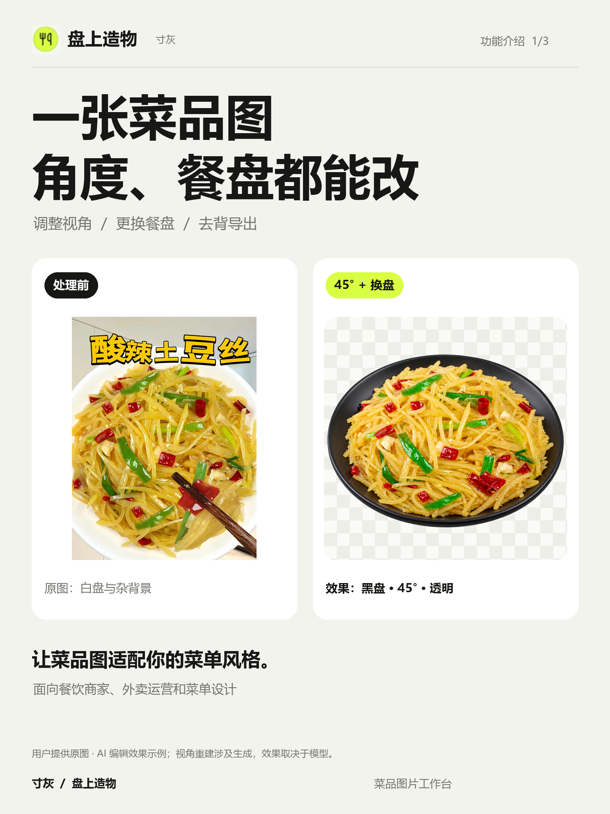
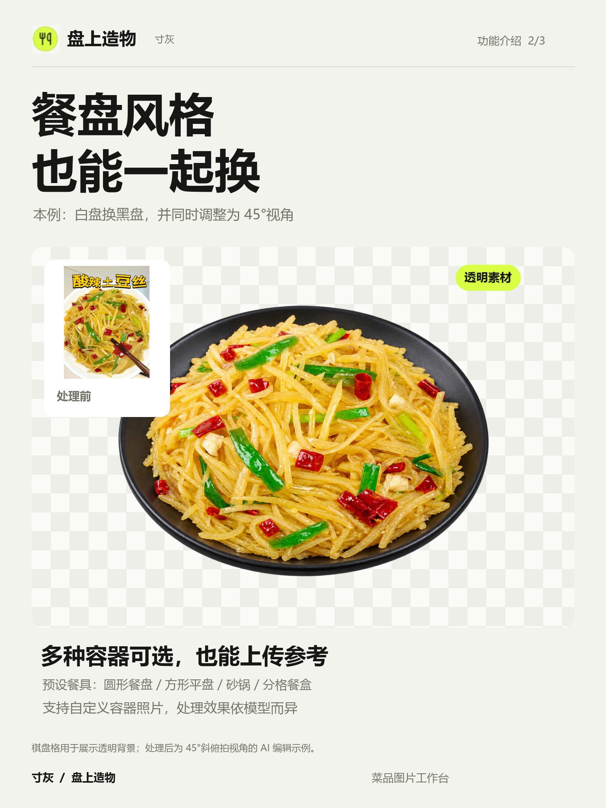
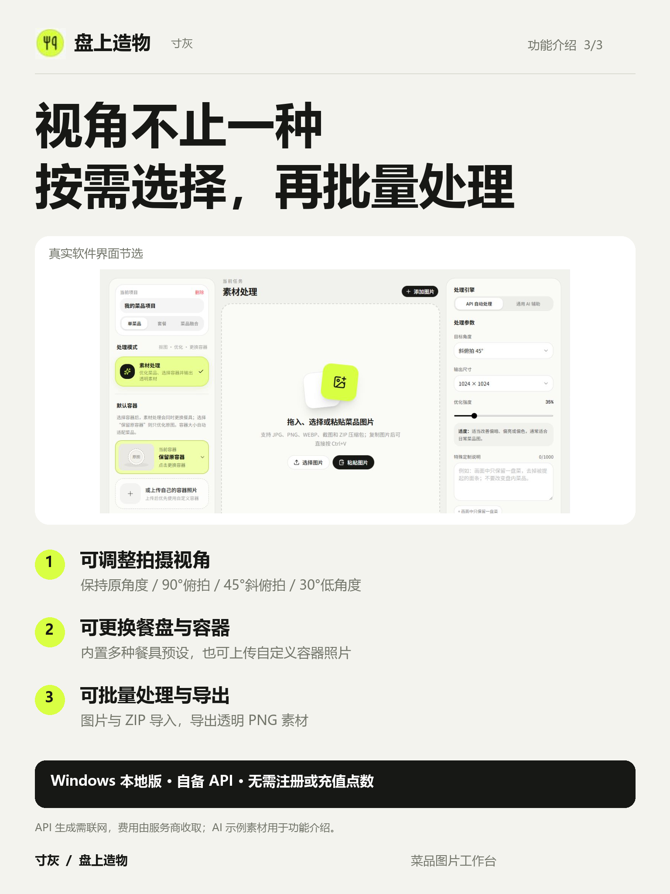

# 盘上造物 · 寸灰

Windows 本地菜品图片工作台 · v0.2.1

## 下载与使用

到 [Releases 下载最新版](https://github.com/kuang123-11/panshangzaowu/releases/latest)，完整解压 Windows x64 分享包，双击「盘上造物.exe」，无需安装 Node.js。

首次使用在右上角设置自己的 API 地址、密钥和图像编辑模型。无需注册或充值点数；图片生成需要联网，API 费用由服务商收取。

## 功能

- 可调整视角：保持原角度、90°俯拍、45°斜俯拍、30°低角度。
- 可更换餐盘与容器：多种预设，也能上传自己的容器参考照片。
- 菜品优化、去背景与透明 PNG 导出。
- 图片/截图/ZIP 批量导入、项目本地保存、套餐组合与菜品融合。

角度调整和补全遮挡内容涉及 AI 重建，结果依模型而异，并非机械旋转或像素级保真保证。下方示例采用用户提供的酸辣土豆丝图片，编辑结果为约 45°黑盘视角；棋盘格仅展示透明背景。并非所有功能和所有服务商均完成真实出图实测。

## 介绍图

## 本地数据

程序旁的 data 文件夹存放 API 配置、项目、缓存与日志。请备份并妥善保管，不要上传或分享给别人。分发时只发送 Releases 中的干净 ZIP。

当前为私有仓库，仅仓库授权成员能访问下载页。

## 开发与打包

干净源码包见 Releases 的 source ZIP。安装 Node.js 22 或更高版本，解压后运行 npm ci。Windows 打包前，将本机 Node 可执行文件复制到源码 runtime/node.exe（详见 runtime/README.md），再运行 npm run desktop:update。

分享版未进行商业代码签名。完整 Electron 窗口与另一台干净 Windows 电脑尚未完成自动实测；已验证构建、随包后台启动、配置保存/读取/清除和发布文件隐私检查。

## 许可

本项目暂未授予开源使用许可；第三方依赖仍遵循其各自许可证。
